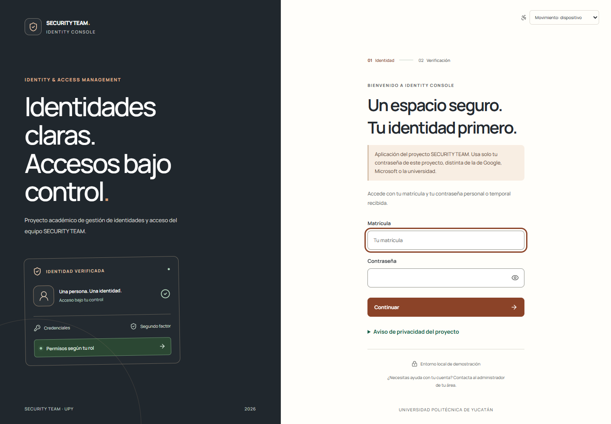
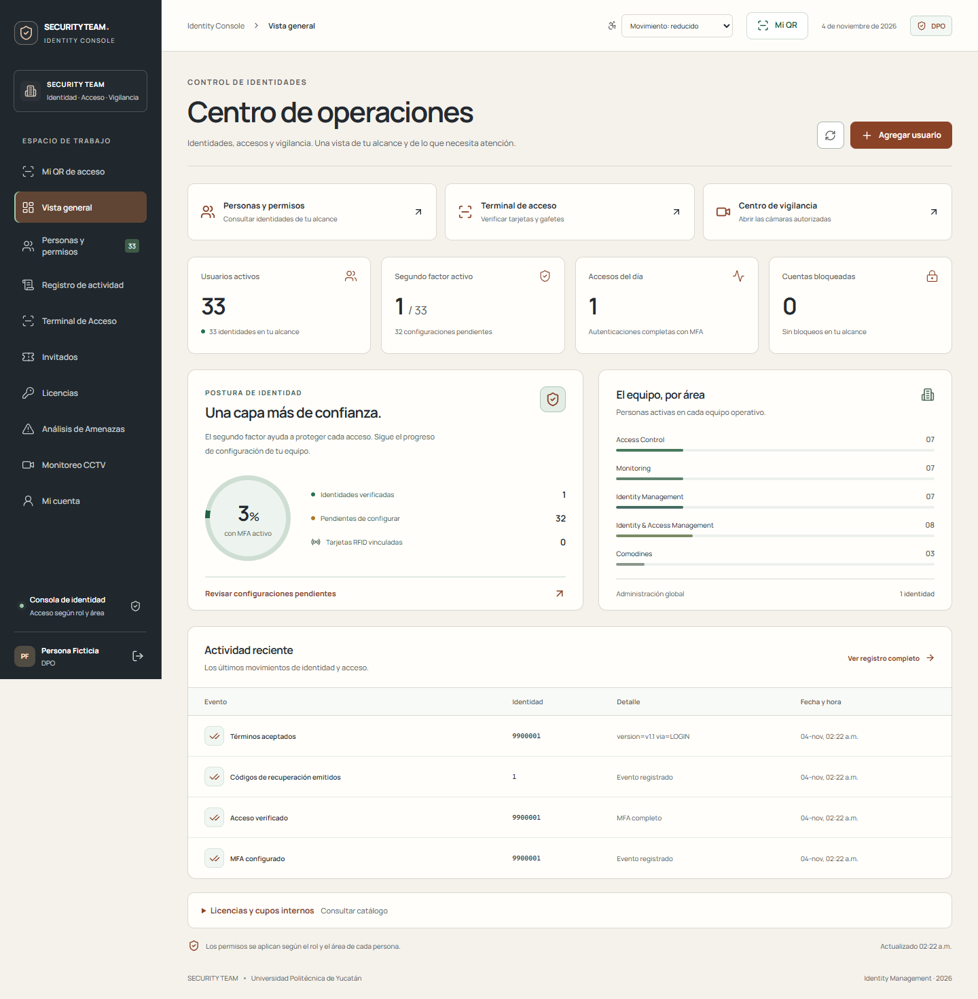
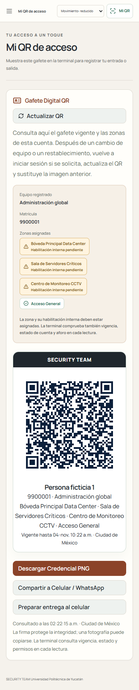
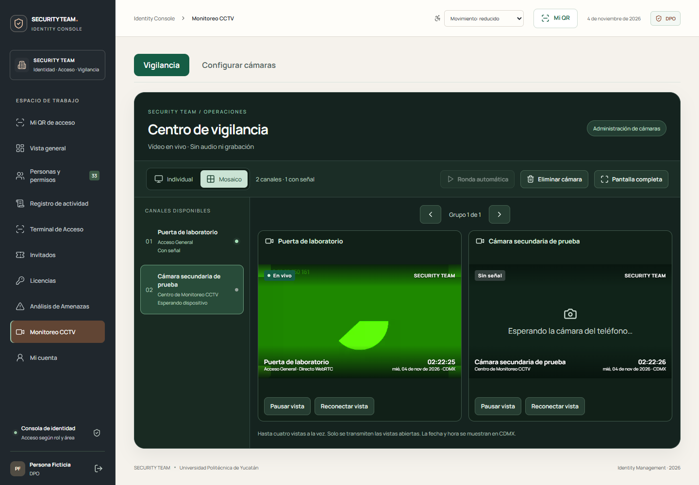

# Interfaz Next · evidencia de ensayo

Capturas generadas por Chromium de Playwright el 4 de noviembre de 2026 con el backend aislado. **Todas las identidades y cámaras son ficticias**; la base temporal se eliminó después. No son capturas de producción ni de Base44. El grafito, papel cálido y cobre se combinan con estados semánticos verdes y ámbar, texto e iconos.

## Entrada

Movimiento reducido aplicado desde el inicio y selector persistente. No se incluyen secretos de autenticador ni códigos de recuperación.

## Operaciones

Accesos a tareas autorizadas y catálogo de licencias desplegable. Los contadores proceden de la base ficticia real del ensayo; no son puntuaciones inventadas de seguridad.

## Gafete móvil

Zonas asignadas y habilitaciones pendientes se distinguen antes de llegar a la terminal. El QR de esta imagen pertenece al entorno ficticio ya eliminado y no sirve para la instalación del salón.

## Vigilancia

Primer canal con vídeo sintético decodificado; segundo canal creado para probar el estado de espera. No se presenta el segundo como cámara conectada. El reloj y la fecha se muestran en Ciudad de México. La ronda, cambio de cámara y revocación también se ensayaron.

